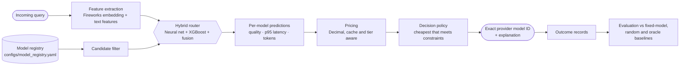

<div align="center">

# 🧭 LLM Router

**Send every prompt to the cheapest Claude model that can handle it.**

A hybrid router that combines a neural network and XGBoost to choose a specific Claude model
version for each query, trading off predicted quality, latency and cost.

<p>
  
  
  
  
  
  
  
  <a href="https://huggingface.co/Trisham97/llm-complexity-router"></a>
</p>
<p>
  
  
  
  
  <a href="LICENSE"></a>
  
</p>



[Overview](#-overview) •
[Results](#-results) •
[Pretrained model](#-pretrained-model) •
[Architecture](#%EF%B8%8F-architecture) •
[Installation](#-installation) •
[Usage](#-usage) •
[Reproduce](#-reproducing-the-experiments) •
[Roadmap](#%EF%B8%8F-roadmap)

</div>

---

## 📌 Overview

Sending every request to a frontier model wastes money and adds latency, because most prompts
don't need it. Sending everything to the smallest model hurts quality on hard prompts.
**LLM Router** predicts, for each query, how well each candidate model would do, then picks the
cheapest one that meets your quality and latency constraints.

- 🧠 **Hybrid prediction:** a neural network learns from semantic query embeddings, XGBoost
  learns from structured features, and a fusion layer combines the two.
- 🏷️ **Version-aware:** it routes to exact provider IDs such as `claude-sonnet-5-5`, not
  "small/medium/large". Candidates, prices and limits live in one YAML registry, so adding a
  model needs no code change.
- 💸 **Cost-correct:** pricing uses `Decimal` and includes cache reads and writes and
  long-context tiers. An unknown price is reported as **unknown**, never as zero.
- 🛡️ **Leakage-safe:** splits are grouped and deduplicated, a near-duplicate audit runs in
  embedding space, models are selected on validation only, and the test set is read once.
- ⚡ **Laptop-friendly:** memory-mapped float32 embeddings and streamed XGBoost
  `QuantileDMatrix`. The full training run fits in **~2.5 GB RAM** and runs on CPU or a 4 GB
  GPU.
- 🔁 **Reproducible:** pinned dataset revisions, SHA-256 provenance, data fingerprints, seeded
  training, and a resumable, cached embedding job.

The first component, a **prompt complexity classifier** (`easy` / `medium` / `hard`), is
trained and evaluated. Complexity is the first signal the routing policy uses.

---

## 📊 Results

Complexity classifier on [`regolo/brick-complexity-extractor`](https://huggingface.co/datasets/regolo/brick-complexity-extractor)
(76,825 prompts after deduplication, grouped 80/10/10 split). Embeddings come from
`fireworks/qwen3-embedding-8b` (4,096 dimensions). Scores are on the **held-out test set
(7,682 prompts)**, evaluated once after model selection on validation.

| Model | Features | Accuracy | Macro-F1 | Hard recall | Hard → easy misroutes | Log loss |
|---|---|:---:|:---:|:---:|:---:|:---:|
| **MLP** (4096→256→128→3) | embeddings | **0.727** | **0.707** | 0.605 | 4.1% | **0.621** |
| MLP | embeddings + engineered | 0.717 | 0.701 | 0.633 | **4.0%** | 0.920 |
| Logistic regression (baseline) | embeddings | 0.719 | 0.695 | 0.566 | 4.5% | 0.628 |
| XGBoost | embeddings + engineered | 0.638 | 0.631 | **0.739** | 8.4% | 0.788 |
| XGBoost | embeddings | 0.624 | 0.617 | 0.723 | 10.5% | 0.816 |
| MLP / XGBoost | engineered only | 0.52 / 0.50 | 0.51 / 0.49 | — | 19–21% | — |

**What the results show:**
- The MLP is the most accurate and the best calibrated model.
- The 16 hand-crafted features add little beyond the embedding (+0.014 macro-F1 for XGBoost,
  −0.006 for the MLP).
- XGBoost catches more hard prompts, but over-predicts `hard` (hard precision is 0.48).
- **Hard→easy misroutes** are tracked separately. That's the costliest error for a router: a
  difficult prompt sent to the cheapest model.

**Cost and speed:**
- Embedding all 76,825 prompts cost about **$0.62** (6.24M tokens).
- The whole seven-experiment comparison took about **19 minutes** on an RTX 3050 Ti laptop GPU.
- Classification takes about **0.2 ms** per prompt. That excludes the embedding API call, which
  takes about 1.4 s.

> Labels come from an LLM judge, so these scores measure agreement with that judge, not with
> human ratings.

---

## 🤗 Pretrained model

The trained complexity router is published at
**[huggingface.co/Trisham97/llm-complexity-router](https://huggingface.co/Trisham97/llm-complexity-router)**.

It ships two classifiers: logistic regression (the default, test macro-F1 0.695) and the MLP
(0.707). Both are stored as plain NumPy weights, so the download contains no pickle files and
needs neither PyTorch nor this repository. The download is also a Claude Code plugin. It adds a
prompt hook that tells Claude the estimated complexity and a suggested tier, a `classify_prompt`
MCP tool, and Haiku / Sonnet / Opus worker subagents. You need [uv](https://docs.astral.sh/uv/)
and a Fireworks API key.

```bash
uvx --from huggingface_hub hf download Trisham97/llm-complexity-router --local-dir ~/llm-complexity-router
export FIREWORKS_API_KEY=fw_...            # PowerShell: $env:FIREWORKS_API_KEY = "fw_..."

# Classify from the command line
uv run --script ~/llm-complexity-router/complexity_router.py classify "Design a lock-free queue"

# Or use it inside Claude Code
claude --plugin-dir ~/llm-complexity-router
```

- **It recommends, it doesn't switch.** Claude Code doesn't let a plugin change the main
  session's model. Switch with `/model`, or let Claude delegate to the matching worker subagent.
- **Privacy:** while the prompt hook is on, every prompt you type is sent to Fireworks AI to be
  embedded. Set `COMPLEXITY_ROUTER_HOOK=off` to disable it.
- **License:** the published weights are **CC BY-NC 4.0** (non-commercial), because the training
  data is.

The model card on the Hub has the full setup, the evaluation, and the limitations. Rebuild the
package from this repository with `uv run python -m llm_router.inference.export_hub`. It checks
that the exported weights reproduce the original models on the whole test set.

---

## 🏗️ Architecture



| Layer | Module | What it does |
|---|---|---|
| Registry | `llm_router.models.registry` | Validated, source-cited records for each model version: lifecycle, capabilities, prices |
| Filtering | `llm_router.routing.candidate_filter` | Drops ineligible candidates and records every reason |
| Features | `llm_router.features` | Fireworks embeddings plus 16 deterministic text features (code, math, structure, length) |
| Models | `llm_router.models` | MLP, XGBoost and logistic-regression complexity classifiers; utility-predictor contract |
| Pricing | `llm_router.evaluation.pricing` | Exact cost estimates; unknown prices stay unknown |
| Policy | `llm_router.routing.policy` | Minimises predicted cost subject to `min_quality` and `max_latency_p95_ms` |
| Inference | `llm_router.inference.classifier` | `ComplexityRouter`: query → embedding → label and probabilities |
| Evaluation | `llm_router.evaluation.model_comparison` | Quality, latency, cost, Pareto front and routing regret on a shared query set |

More detail: [architecture](docs/architecture.md) · [model registry](docs/model_registry.md) ·
[complexity classifier](docs/complexity_classifier.md) · [router dataset](docs/router_dataset.md) ·
[training plan](docs/training_plan.md).

### Project status

| Component | Status |
|---|---|
| Model registry, pricing, candidate filter, decision policy, router orchestration | ✅ Implemented and tested |
| Data pipelines (download, inspect, clean, grouped split, leakage audit) | ✅ Implemented |
| Resumable Fireworks embedding job | ✅ Implemented |
| Complexity classifiers (logistic regression, XGBoost, MLP) and comparison runner | ✅ Trained and evaluated |
| Second dataset (`small_llm` / `large_llm` routing labels) | ✅ Prepared and embedded; 🧪 experiments ongoing |
| Fusion utility predictor (per-model quality, latency, tokens) | 🚧 Interface only |
| Preference / reward optimisation | 🗓️ Planned |
| Serving API and provider adapters | 🗓️ Planned |

---

## 📦 Installation

### Prerequisites

- **Python 3.12**. uv can install it for you.
- **[uv](https://docs.astral.sh/uv/)**, the only supported package manager. Don't use pip,
  Poetry or Conda.
- **Optional:** an NVIDIA GPU with a recent driver. On Windows the CUDA 13.0 build of PyTorch
  is installed automatically. Everything also runs on CPU.
- **Optional:** a [Fireworks AI](https://fireworks.ai) API key, needed only to generate
  embeddings or classify new text.

### Setup

```bash
# 1. Install uv (see https://docs.astral.sh/uv/ for other methods)
curl -LsSf https://astral.sh/uv/install.sh | sh          # macOS / Linux
# powershell -c "irm https://astral.sh/uv/install.ps1 | iex"   # Windows

# 2. Clone
git clone https://github.com/<your-username>/llm-router.git
cd llm-router

# 3. Install dependencies
uv sync                         # core + dev tools
uv sync --group complexity      # + datasets, Fireworks client, PyTorch (complexity classifier)
uv sync --all-groups            # everything (neural, serving, experiments, complexity)

# 4. Configure secrets (only needed for embedding calls)
cp .env.example .env            # PowerShell: Copy-Item .env.example .env
#    then set FIREWORKS_API_KEY and FIREWORKS_EMBEDDING_MODEL=fireworks/qwen3-embedding-8b

# 5. Check the install
uv run python scripts/validate_environment.py
uv run pytest
```

| Dependency group | Contents |
|---|---|
| *(core)* | numpy, pandas, scikit-learn, xgboost, pydantic, pyyaml, structlog |
| `complexity` | datasets, openai (Fireworks client), torch, psutil, matplotlib, python-dotenv |
| `neural` | torch, sentence-transformers |
| `serving` | fastapi, uvicorn |
| `experiments` | mlflow, tqdm, python-dotenv |
| `dev` | pytest, ruff, mypy |

> 🔐 `.env` is git-ignored. The API key is read only when a request is about to be made, and is
> never printed, logged or written to artifacts.

---

## 🚀 Usage

### Try the full pipeline without an API key

The smoke test runs every stage on synthetic data with mocked embeddings. It costs nothing and
needs no credentials.

```bash
uv run python -m llm_router.training.smoke_complexity
uv run python -m llm_router.training.run_comparison --smoke
```

### Classify a prompt

This needs a trained model in `artifacts/models/` (see [Reproduce](#-reproducing-the-experiments))
and a Fireworks key.

```python
from llm_router.inference.classifier import ComplexityRouter

router = ComplexityRouter.from_pretrained("artifacts/models/mlp")
result = router.predict("Design a distributed scheduler that minimizes GPU idle time.")
print(result.to_dict())
# {'label': 'hard', 'probabilities': {'easy': ..., 'medium': ..., 'hard': ...},
#  'classifier': 'mlp', 'embedding_model': 'fireworks/qwen3-embedding-8b'}

router.predict_batch(["What is 2 + 2?", "Refactor this module for testability."])

# Offline: classify cached vectors without calling the API
offline = ComplexityRouter.from_pretrained("artifacts/models/mlp", offline=True)
offline.predict_embeddings(vectors)
```

`ComplexityRouter.from_config("configs/complexity.yaml")` loads whichever classifier
(`logistic_regression`, `xgboost` or `mlp`) is set in the config. The router refuses to run if
the embedding model, the vector dimension or the feature definitions differ from those used in
training.

### Work with the model registry

```bash
# Every candidate lives in configs/model_registry.yaml; the tests validate the shipped file
uv run pytest tests/unit/models tests/unit/routing
```

To add a model version, follow [Adding a new model version](docs/model_registry.md#5-adding-a-new-model-version).
Routing code doesn't change.

---

## 🔬 Reproducing the experiments

**Datasets and trained models aren't included in this repository.** The trained router is
available on the [Hugging Face Hub](https://huggingface.co/Trisham97/llm-complexity-router). To
rebuild everything yourself, follow the steps below. Downloads and preprocessing are free and deterministic. Embedding calls are paid, so run
`--plan` and a small pilot first.

```bash
# 1. Data: download (pinned revision, hash-verified), inspect, clean and split 80/10/10
uv run python -m llm_router.data.download
uv run python -m llm_router.data.inspect
uv run python -m llm_router.data.preprocess

# 2. Embeddings (Fireworks): connectivity test, free plan, small pilot, full resumable run
uv run python -m llm_router.embeddings.fireworks_client --test
uv run python -m llm_router.embeddings.generate --plan
uv run python -m llm_router.embeddings.generate --max-batches 5
uv run python -m llm_router.embeddings.generate --yes          # ≈ $0.62, resumable

# 3. Train and compare every model (validation-based selection, a single test pass)
uv run python -m llm_router.training.run_comparison --device auto
#    or train one model at a time
uv run python -m llm_router.training.train_xgboost --feature-set embeddings+engineered
uv run python -m llm_router.training.train_mlp     --feature-set embeddings --device cuda
```

The report is written to `artifacts/reports/comparison/comparison.md`. It covers validation and
test tables, per-class metrics, confusion matrices, calibration, peak memory and latency.

<details>
<summary><b>Second dataset: <code>DevQuasar/llm_router_dataset-synth</code></b></summary>

This dataset has binary `small_llm` / `large_llm` routing labels (Apache-2.0). Its official
train and test splits share 400 identical prompts, so the pipeline deduplicates it and re-splits
it by group.

```bash
uv run python -m llm_router.data.inspect_router_dataset
uv run python -m llm_router.data.prepare_router_dataset
uv run python -m llm_router.embeddings.generate_router_embeddings --estimate
uv run python -m llm_router.embeddings.generate_router_embeddings --yes   # ≈ $0.04

# Optional: merge it into the complexity training set (large_llm → hard, small_llm → medium)
uv run python -m llm_router.data.build_merged_dataset
uv run python -m llm_router.training.run_comparison --config configs/complexity_merged.yaml
```

See [`docs/router_dataset.md`](docs/router_dataset.md).
</details>

<details>
<summary><b>Training on Lightning AI</b></summary>

```bash
bash scripts/setup_lightning_complexity.sh      # uv sync, data checks, smoke run
uv run python -m llm_router.training.run_comparison --threads 8
```

Copy `data/` and `artifacts/embeddings/` to the Studio, but never `.env`. Details are in
[`docs/complexity_classifier.md`](docs/complexity_classifier.md#running-on-lightning-ai).
</details>

---

## 🗂️ Project structure

```text
llm-router/
├── configs/                 # YAML configs: registry, routing policy, complexity, datasets, training
├── data/                    # local datasets (git-ignored; see data/README.md)
├── artifacts/               # embeddings, trained models, reports (git-ignored)
├── docs/                    # design docs and the animated diagram
├── notebooks/               # exploratory analysis
├── packaging/hub/           # Claude Code plugin template (prompt hook, MCP tool, tier subagents)
├── scripts/                 # local and Lightning AI setup, environment validation
├── src/llm_router/
│   ├── data/                # download, inspect, preprocess, grouped splitting, leakage audit
│   ├── embeddings/          # Fireworks client and resumable, cached embedding job
│   ├── features/            # engineered text features, feature assembly, candidate features
│   ├── models/              # registry, MLP, classifier backends, utility-predictor contract
│   ├── training/            # XGBoost / MLP / baseline trainers, comparison runner
│   ├── inference/           # ComplexityRouter
│   ├── routing/             # candidate filter, decision policy, router
│   ├── evaluation/          # pricing, model comparison, quality / cost / latency
│   ├── optimization/        # preferences and rewards (planned)
│   ├── serving/             # API (planned)
│   └── monitoring/          # metrics and telemetry (planned)
├── tests/                   # unit / integration / evaluation tests (mocked API, no charges)
├── pyproject.toml
└── uv.lock
```

---

## 🧪 Development

```bash
uv run pytest                    # unit tests; GPU tests skip automatically without CUDA
uv run ruff check .              # lint
uv run ruff format --check .     # formatting
uv run mypy                      # strict type checking
```

Project conventions:
- Use `uv` only.
- Configuration over code.
- Never hardcode model IDs; they belong in the registry.
- Never select on the test split.
- Developer tooling stays out of the `llm_router` package. See
  [`docs/developer_tooling.md`](docs/developer_tooling.md).

---

## 🗺️ Roadmap

- [x] Version-aware model registry, pricing, candidate filter and decision policy
- [x] Data pipelines with grouped, leakage-safe splits
- [x] Cached, resumable Fireworks embeddings
- [x] Complexity classifiers (logistic regression, XGBoost, MLP) with GPU support
- [ ] Training checkpoints and `--resume` for the comparison runner
- [ ] Hyperparameter search and probability calibration
- [ ] Collect per-model outcomes (quality, latency, cost) on a frozen evaluation set
- [ ] Fusion utility predictor (neural net + XGBoost)
- [ ] Preference / reward optimisation of the routing policy
- [ ] Benchmarks against fixed-model, random and oracle routers
- [ ] Serving API and provider adapters

---

## 📄 License and data

The code is released under the [MIT License](LICENSE). The
[published model](https://huggingface.co/Trisham97/llm-complexity-router) is licensed separately
under **CC BY-NC 4.0**, because it was trained on CC BY-NC data.

The datasets aren't distributed here and keep their own licenses:

| Dataset | License | Notes |
|---|---|---|
| [`regolo/brick-complexity-extractor`](https://huggingface.co/datasets/regolo/brick-complexity-extractor) | **CC BY-NC 4.0** | Attribution required, **non-commercial only**; this applies to models trained on it too |
| [`DevQuasar/llm_router_dataset-synth`](https://huggingface.co/datasets/DevQuasar/llm_router_dataset-synth) | Apache-2.0 | Labelling method undocumented by the source |

Model names, IDs and prices in `configs/model_registry.yaml` were checked against Anthropic's
public documentation on 2026-10-10. Re-verify them before relying on them.

<div align="center">

**If this project helps you, consider giving it a ⭐**

</div>
