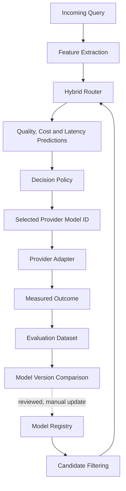

# Model Registry

The registry, [`configs/model_registry.yaml`](../configs/model_registry.yaml), is the single
source of candidate model versions for the router. It records what is *known and verified* about
each candidate. It never selects a model; that is the decision policy's job.

## 1. Purpose and architecture



The dashed edge is deliberate. Benchmark results reach the registry only when someone copies a
reviewed evaluation summary into it. Nothing updates routing or activates a model automatically.

| Step | Module | Status |
|---|---|---|
| Registry schema, loading, validation | `llm_router.models.registry` | implemented |
| Candidate filtering | `llm_router.routing.candidate_filter` | implemented |
| Candidate features | `llm_router.features.structured_features.candidate_features` | implemented |
| Hybrid predictions (neural + XGBoost + fusion) | `llm_router.models.utility_predictor.UtilityPredictor` | **contract only**; no model |
| Cost estimation | `llm_router.evaluation.pricing` | implemented |
| Decision policy | `llm_router.routing.policy` | implemented |
| Orchestration | `llm_router.routing.router.Router` | implemented; needs a predictor |
| Provider adapter (calling the model) | `llm_router.serving` | not implemented |
| Outcome records | `llm_router.schemas.OutcomeRecord` | implemented |
| Version comparison | `llm_router.evaluation.model_comparison` | implemented (on recorded outcomes) |
| Catalogue ingestion | `llm_router.data.model_catalog` | Anthropic Models API parser (fixture-tested); Bedrock not implemented |

How a request is routed (`Router.route`):

1. The filter takes the request's token sizes, required capabilities and parameters, and
   provider, region, and allow/deny restrictions, and drops every ineligible candidate. Each
   exclusion gets a reason.
2. The predictor receives the query features and the eligible candidates. It must return one
   prediction per candidate: quality, P95 latency, and completion tokens, each `None` if unknown.
3. Cost is computed from each candidate's own registry prices and the predicted tokens.
4. The policy picks the cheapest candidate meeting `min_quality` and `max_latency_p95_ms`, using
   the settings in [`configs/routing_policy.yaml`](../configs/routing_policy.yaml).
5. The result holds the canonical `model_id`, the `provider`, and the exact `provider_model_id`
   to send, plus an explanation of the filter and the decision.

If no candidate meets the constraints, the configured fallback applies.
`no_feasible_candidate` (the default) returns no selection. `maximize_utility` selects by
weighted utility and marks the result `constraints_satisfied: false`. Constraints are never
relaxed silently.

## 2. Schema

`schema_version: 1`. The top-level keys are `models` and `pending_candidates`. The loader ignores
top-level keys that start with `_`, which hold YAML anchors for shared sources. Unknown keys
anywhere else are rejected.

### Candidate record

| Field | Meaning |
|---|---|
| `model_id` | Canonical internal ID, `<provider>/<name>`, unique in the registry |
| `display_name`, `family`, `version` | Descriptive only; never used as routing destinations |
| `provider` | Provider/platform key, e.g. `anthropic`, `amazon-bedrock` |
| `lifecycle` | `status`, `enabled`, `verified_at`, `effective_from`, `effective_until`, `retirement_not_before`, `sources` |
| `capabilities` | `context_window_tokens`, `max_output_tokens`, `supports_tools`, `supports_vision`, `supports_structured_output`, `parameters`, `verified_at`, `sources` |
| `pricing` | `currency`, `unit` (`per_million_tokens`), `input`, `output`, `cache_read`, `cache_write_5m`, `cache_write_1h`, `tiers`, `verified_at`, `sources` |
| `provider_metadata` | `api_model_id`, `api_model_alias`, `deployment_name`, `region`, `sources` |
| `benchmark` | `status`, `quality_score` [0–1], `latency_p50_ms`, `latency_p95_ms`, `benchmark_dataset_version`, `evaluation_run_id`, `measured_at` |
| `notes` | Free text |

Each `sources` entry is `{url, checked_at, note?}`.

The original draft schema's `cached_input` maps to `cache_read`. Its single `cache_write` became
`cache_write_5m` and `cache_write_1h`, because Anthropic prices the two cache durations differently.

### Validation rules

The loader rejects a record (with its index and `model_id` in the error) when:

- `model_id` is duplicated, or doesn't start with `<provider>/`;
- two candidates share the same `(provider, api_model_id)`;
- a price is negative, a boolean, or non-numeric;
- prices are present without `verified_at` and a source;
- tiers aren't in strictly increasing threshold order, have duplicate names, or use an
  unsupported `scope`;
- a candidate is `enabled` while `unverified`, `retired`, or `unavailable`, or has no `api_model_id`;
- a status other than `unverified` lacks `verified_at` and a source;
- `effective_from` is after `effective_until`, or `max_output_tokens` exceeds `context_window_tokens`;
- a `not_evaluated` benchmark carries metrics, or an evaluated one lacks a run ID, dataset
  version, date, or metric.

All problems are collected and reported together (`RegistryValidationError.issues`).

## 3. Lifecycle states

| Status | Meaning | Routable? |
|---|---|---|
| `unverified` | Not confirmed from an authoritative source (the default) | never |
| `active` | Provider: fully supported | if enabled |
| `legacy` | Provider: still served, no updates | if enabled |
| `deprecated` | Provider: still served, retirement scheduled | only if `candidate_filter.allowed_statuses` includes it |
| `retired` | Provider: requests fail | never |
| `unavailable` | Not reachable for this project (access, region, account) | never |

`enabled: true` is a project opt-in, not proof of availability. A candidate is routed to only if
it is enabled, has a routable status, has an `api_model_id`, and passes the per-request filter.
That filter also checks `effective_from` / `effective_until` against the current date.
`retirement_not_before` records the provider's commitment for information only.

## 4. Canonical IDs vs provider IDs

- `model_id` (e.g. `anthropic/claude-haiku-4-5`) is the stable internal key, used in configs,
  outcome records, and evaluation.
- `provider_metadata.api_model_id` (e.g. `claude-haiku-4-5-20251001`) is the exact string sent to
  the provider. Use pinned snapshot IDs where a provider offers them. Store aliases in
  `api_model_alias`; they are informational only.
- The same model on another platform is a separate candidate with its own ID, lifecycle, and
  prices. For example, `amazon-bedrock/claude-opus-5-5` sends `anthropic.claude-opus-5-5`.

## 5. Adding a new model version

1. Confirm the model on the provider's documentation: exact API model ID, lifecycle status, context
   window, max output, and prices. Note each URL and the date you checked it.
2. Add a record to `models`. Leave anything you could not confirm as `null`.
3. Keep `enabled: false` until the record has been reviewed. Then set `status` and `enabled: true`.
4. Run `uv run pytest tests/unit`. The shipped-registry tests check the invariants.
5. Routing code does not change. Run a benchmark (section 9) before relying on the model.

If a requested version cannot be verified, add it under `pending_candidates` with the reason and
the sources you checked. Never guess an ID or copy prices from a neighbouring version.

## 6. Verifying availability and pricing

- Anthropic first-party: [models overview](https://platform.claude.com/docs/en/models/overview),
  per-model pages (`https://platform.claude.com/docs/en/models/<model>/overview`),
  [pricing](https://platform.claude.com/docs/en/about-claude/pricing), and
  [model deprecations](https://platform.claude.com/docs/en/about-claude/model-deprecations).
- The Models API (`GET /v1/models`) reports `max_input_tokens`, `max_tokens`, `capabilities`, and
  `line` for models your key can access. Parse it with `AnthropicModelsAdapter`, then merge it
  with `merge_catalog` (section 11).
- Partner platforms (Amazon Bedrock, Google Cloud) set their own prices and lifecycle dates.
  Verify those on the platform's own pages. Anthropic's pricing does not apply there.
- Re-verify before every experiment and update `verified_at`.

## 7. Capabilities and context limits

- `context_window_tokens` and `max_output_tokens` are hard limits. The filter requires
  `input_tokens + max_output_tokens <= context_window_tokens`, a conservative assumption that
  output shares the window.
- `supports_*` fields are `true`, `false`, or `null` (unknown). A request needing a capability
  excludes every candidate where it is `false` **or** `null`.
- `parameters` maps a request parameter to whether it can be set to a non-default value. A
  missing key means unknown.

In the shipped registry, `supports_tools` is `true` only where Anthropic's docs state tool use
for current models (Haiku 5.5, Sonnet 5.5, Opus 5.5). It is `null` for the legacy models, whose
pages don't state it, so those models are excluded from tool-requiring requests until verified.
`supports_structured_output` is `null` everywhere for the same reason.

## 8. Cached and long-context pricing

- `TokenUsage.input_tokens` counts **uncached** input only. Cache reads and the two cache-write
  durations are counted separately, so no token is priced twice.
- A component's price is needed only if that component has tokens. A missing needed price
  returns `UnknownCost` with the missing components. It never returns zero or a partial total.
- `tiers` reprice the **entire request** when the prompt (all input tokens, including cache reads
  and writes) is **strictly greater than** `applies_when_prompt_tokens_over`. A prompt of exactly
  the threshold uses the base prices. The highest qualifying tier wins. A price missing from a
  tier is unknown; it never falls back to the base price.
- Not modelled: batch discounts, the US-only `inference_geo` multiplier (1.1×), fast mode, and
  partner-platform prices. Estimates assume standard, global, first-party pricing.
- `BilledCost` holds provider-reported charges. It is a separate type from `CostEstimate`, and
  `OutcomeRecord` keeps `estimated_cost` and `actual_cost` in separate fields.

## 9. Benchmarking a new model

1. Run the model on the frozen evaluation set (`data/evaluation/`) and record one `OutcomeRecord`
   per query: dataset version, evaluation version, tokens, quality and method, latency
   boundaries, estimated and actual cost.
2. Compare it with `compare_models` against the other versions on the **same** query set. The
   function refuses mixed dataset versions, mixed evaluation versions, or different query sets.
3. Look at quality, error and timeout rates, P50/P95 latency, cost, the cost-quality Pareto
   front, quality-constrained savings, and routing regret, overall and per task category.
4. After review, copy the summary into the record's `benchmark` block with `evaluation_run_id`.
   Measured metrics belong only in evaluation outputs and this reviewed summary, never in code.

A newer version is never assumed to be better. Until it is evaluated, `benchmark.status` is
`not_evaluated` and its metrics are `null`, which is different from zero.

## 10. Disabling, deprecating, retiring

- **Stop routing immediately:** set `enabled: false`, or add the ID to
  `candidate_filter.denylist` in `routing_policy.yaml`.
- **Provider deprecation:** set `status: deprecated` and set `effective_until` to the retirement
  date. Deprecated candidates are excluded unless explicitly allowed.
- **Retired:** set `status: retired` and `enabled: false`. Keep the record so historical outcome
  records still resolve.
- **Unavailable to this project** (no access, region): `status: unavailable`.

## 11. Running tests

```bash
uv run pytest tests/unit                        # all unit tests (no network, no API keys)
uv run pytest tests/unit/models/test_registry.py
uv run ruff check . && uv run mypy
```

## 12. Limitations and outstanding integrations

- **No predictor.** `UtilityPredictor` is a contract only. Until the neural, XGBoost, and fusion
  models exist, `Router` cannot make real decisions. Tests use a fixed-table test double.
- **Catalogue ingestion is offline.** `AnthropicModelsAdapter` parses a Models API response
  passed in by the caller and is tested on a fixture. It does not fetch. It does not map the
  `capabilities` object to `supports_*` until each key is verified.
- **Amazon Bedrock:** model IDs are recorded from Anthropic's docs, but Bedrock prices,
  lifecycle, regions, and model access are not verified. Those candidates are `unverified` and
  disabled, and no Bedrock catalogue adapter exists yet.
- **Not modelled:** cache usage in routing-time cost estimates (cache hits are assumed to be
  zero), batch, `inference_geo`, and fast-mode pricing.
- **Escalation:** `escalation` in `routing_policy.yaml` is not implemented.
- **Opus 4.9** could not be verified (see `pending_candidates`).
- **Lifecycle dates change.** Claude Haiku 4.5's retirement is "not sooner than 2026-10-15";
  re-check it before every experiment.
